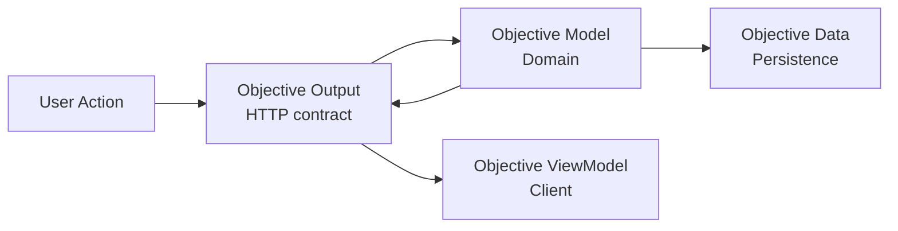

DATA FLOW
=========

During its lifecycle, data exists in three different representations: the domain layer, the persistence layer, and the client layer.

Domain Layer
------------

The domain layer contains the business logic of the application. It is mainly composed of use cases and entities.

A use case should not exist because a client needs an action for a specific screen. It should exist because it represents a meaningful capability of the application.

The domain layer should describe useful actions and processes that help users achieve their goals, independently of any user interface.

For example:

-   `GetAllObjectives` only exposes stored data.
-   `GetImportantObjectivesForToday` represents a business intention because it applies rules to determine which objectives need attention.

This is where data is in its **awake / working** state.

Persistence Layer
-----------------

The persistence layer is responsible for storing and retrieving data.

Repositories are the bridge between the domain and the storage. The domain should not know how data is stored or retrieved.

The persistence layer contains data in its **sleep** state.

Client Layer
------------

The client layer is responsible for presenting domain capabilities to the user.

It is a separate application built on top of the domain layer. It has its own constraints, such as performance, user experience, and rendering.

The client does not directly use domain data. It uses a representation adapted for the user interface: the **View Model**.

The client layer contains data in its **ready to be displayed** state.

Data Representation
-------------------

Example: defining a new objective.

The domain and persistence layers live in the server. Between the server and the clients, data travels in a fourth shape: the **HTTP contract** (the request and response schemas of the API, documented in `docs/api.md` of apex-brain). The clients build their View Models from it.

Applications
------------

There are currently three software systems:

-   `apex-brain` (repository `tiffan-source/apex-brain`): the server. It holds the domain and persistence layers — the core business logic, Supabase, Gemini, Firebase and Akari's workflow — and exposes the capabilities over a REST API.
-   `apex-client` (this repository): the web application used by the person.
-   the mobile application (React Native, Expo).

The clients are complete applications with their own architecture and data flow. They only consume the capabilities exposed by the API. In the web client:

-   `apps/apex-client/src/chore/api/` calls the API: `api.models.ts` describes the HTTP contract, one service per context (`ObjectivesApi`, `AssistantApi`, `AuthApi`) calls its routes, and every failure becomes an `ApiError` carrying the API's error code;
-   the stores (`chore/stores/`) send the person's gestures through these services, optimistically;
-   the mappers (`chore/mapper/`) turn the HTTP contract into View Models.

Rules still in the client
-------------------------

The API does not expose these yet, so the web client still derives them from what `GET /v1/objectives` returns. Each one should move to the server (a computed field or a use case), where the mobile application can share it:

-   the Eisenhower quadrant of a step (threshold 3 on importance and urgency, `quadrantOf`) and the levels a step gets when it is moved to a quadrant (`levelsForQuadrant`), in `chore/mapper/matrix.mapper.ts`. The quadrant in `TaskOutput` and a `MoveTaskToQuadrant` use case would replace them;
-   the progress of an objective and of its stages — a stage done, the stage in progress, the next step, an objective « accomplished » (`isStageDone`, `stageStates`, `nextTaskOf`, `isAccomplished`), in `chore/mapper/objective-view.mapper.ts`.

No other business rule belongs in the client: a new one goes into the API first.
