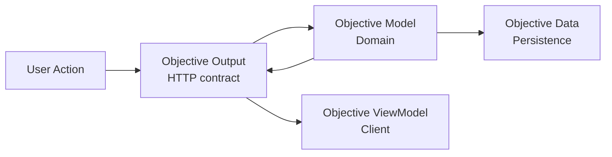

DATA FLOW
=========

During its lifecycle, data exists in four different representations: the domain and persistence layers, which live in the server (Apex Brain), the HTTP contract the server and its clients exchange, and the client layer.

Domain Layer
------------

The domain layer contains the business logic of the application. It is mainly composed of use cases and entities.

A use case should not exist because a client needs an action for a specific screen. It should exist because it represents a meaningful capability of the application.

The domain layer should describe useful actions and processes that help users achieve their goals, independently of any user interface.

For example:

-   `GetAllObjectives` only exposes stored data.
-   `GetImportantObjectivesForToday` represents a business intention because it applies rules to determine which objectives need attention.

This is where data is in its **awake / working** state.

Persistence Layer
-----------------

The persistence layer is responsible for storing and retrieving data.

Repositories are the bridge between the domain and the storage. The domain should not know how data is stored or retrieved.

The persistence layer contains data in its **sleep** state.

Client Layer
------------

The client layer is responsible for presenting domain capabilities to the user.

It is a separate application built on top of the domain layer. It has its own constraints, such as performance, user experience, and rendering.

The client does not directly use domain data. It uses a representation adapted for the user interface: the **View Model**.

The client layer contains data in its **ready to be displayed** state.

Data Representation
-------------------

Example: defining a new objective.

The domain and persistence layers live in the server. Between the server and the clients, data travels in a fourth shape: the **HTTP contract** (the request and response schemas of the API, documented in `docs/api.md` of apex-brain). The clients build their View Models from it.

Applications
------------

There are currently three software systems:

-   `apex-brain` (repository `tiffan-source/apex-brain`): the server. It holds the domain and persistence layers — the core business logic, Supabase, Gemini, Firebase and Akari's workflow — and exposes the capabilities over a REST API.
-   `apex-client` (this repository): the web application used by the person.
-   the mobile application (React Native, Expo).

The clients are complete applications with their own architecture and data flow. They only consume the capabilities exposed by the API. In the web client:

-   `apps/apex-client/src/chore/api/` calls the API: `api.models.ts` describes the HTTP contract, one service per context (`ObjectivesApi`, `AssistantApi`, `AuthApi`) calls its routes, and every failure becomes an `ApiError` carrying the API's error code;
-   the stores (`chore/stores/`) send the person's gestures through these services, optimistically;
-   the mappers (`chore/mapper/`) turn the HTTP contract into View Models.

What the client does not compute
--------------------------------

The web client holds no business rule. It does not decide whether a stage is done or in progress, which step comes next, whether an objective is « accomplished », nor in which Eisenhower quadrant a step falls or what levels a step gets when it is moved to a quadrant. These are Apex Brain's rules (the decisions are written in `docs/features/migration-empreinte.md`, § 4), shared with the mobile application.

The API does not return them yet, so the screens do not show them (removed from the client on 2 November 2026):

-   the arête draws every stage the same way, with its number of steps under its name, and opens on the first stage;
-   the objective cards show the objective, its horizon, its « why » and how many stages and steps it holds — no progress, no next step, no « Accomplis » list;
-   the matrix screen is withdrawn (`/matrice`, `/matrix` and `/focus` lead home), and so is « move to a quadrant ».

To bring them back, the API returns them first — computed fields in `GET /v1/objectives` (the state of a stage, the next step, an objective accomplished, the quadrant of a step) and a `MoveTaskToQuadrant` use case — then the client maps and displays them. Never compute them in the client.

What stays in the client is presentation and form values, not rules: the names of the five importance and urgency levels (`IMPORTANCE_OPTIONS`, `URGENCY_OPTIONS`) and the levels pre-selected in the « Ajouter un pas » sheet (`NEW_TASK_LEVELS`, which the person changes), all in `chore/constants/task.constante.ts`. The client sends the levels; which quadrant they put a step in is the API's answer.
